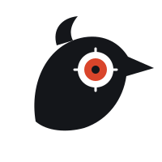

<p align="center">
  
</p>

<h1 align="center">drongo</h1>

<p align="center">
  <b>Direct georeferencing for drone video.</b><br>
  From flight telemetry to where every pixel is on the ground &mdash; for any camera angle, recorded or live.
</p>

<p align="center">
  <a href="https://github.com/arie-distillo/drongo/actions/workflows/ci.yml"></a>
  <a href="https://pypi.org/project/drongo-geo/"></a>
  
  <a href="LICENSE"></a>
</p>

---

**drongo** reads the telemetry that drones record with their video and gives you, for any frame,
an exact model of the camera: pixel &harr; latitude/longitude, frame and tile footprints, ground
resolution, the horizon, and the camera motion between frames. It works the same for straight-down,
oblique and rolled views, for recorded files and for live streams, and it tells you when the
telemetry does not match the video.

```python
from drongo import CameraModel, TelemetryPoseProvider, open_telemetry

provider = TelemetryPoseProvider(open_telemetry("flight.mp4"), CameraModel.preset("mavic3_wide"))
g = provider.geometry(t_ms=12_500, img_w_px=3840, img_h_px=2160)
g.pixel_to_lat_lon([[1920, 1600], [2400, 1450]])     # -> [[lat, lon], [lat, lon]]
```

## Why drongo

Almost every application that analyses drone video needs this geometry, and most write their own.
The same mistakes recur: footprints computed as if the camera points straight down, then applied to
oblique footage; bilinear interpolation between footprint corners, which is exact only at nadir;
sensor dimensions from a spec sheet applied to 16:9 video recorded on a 4:3 sensor; heading
interpolated from 359&deg; to 1&deg; through 180&deg;; proprietary metadata decoded with the wrong
field map and passed on unchecked; and no way to tell any of this from plausible-looking numbers.
drongo does the geometry once, exactly, with tests &mdash; and checks the telemetry against the
video itself.

## Features

- **One exact camera model** for every attitude: pixel &rarr; ground by ray&ndash;plane
  intersection, ground &rarr; pixel, plane homographies, horizon, footprints clipped below it,
  ground sample distance, off-nadir angle. Points above the ground are handled by giving their height.
- **Telemetry in**: DJI SRT sidecars (all known layouts), DJI metadata embedded in MP4/MOV
  (pure Python, no ffmpeg or exiftool), a live packet decoder, or your own source through a
  two-method reader interface. Impossible values are rejected and counted, and a missing or
  unreadable source is explained, reader by reader.
- **Live use**: append telemetry as it arrives; frames that are ahead of the newest telemetry are
  placed by extrapolating the recent motion. A 4K frame's geometry, 100 projected points and
  24 tile footprints cost about 3 ms.
- **Diagnostics**: one command produces an HTML report for a clip &mdash; telemetry sanity checks,
  telemetry-vs-video consistency, the telemetry clock offset, and frames draped on satellite imagery.
- **Synthetic flights with known answers** for testing your own pipeline: rendered video plus SRT
  or embedded telemetry, with configurable noise, bias and clock offset.
- **Small and typed**: the core depends only on numpy; OpenCV is optional.

## Installation

```bash
pip install drongo-geo                 # core (numpy only)
pip install "drongo-geo[cv]"           # + OpenCV: rectification, examples
pip install "drongo-geo[testbed]"      # + test suite, diagnostics and synthetic data tools
```

The distribution is called `drongo-geo`; the package you import is `drongo`.
From a clone: `pip install -e ".[testbed]"`. Python 3.10&ndash;3.13 on Linux, macOS and Windows.

## Quick start

The examples below run as written, in order, from a folder containing `clip.mp4`
and its telemetry sidecar `clip.SRT`. The test suite runs them on a synthetic clip
(`testbed/tests/test_readme.py`), so they stay correct as the code changes.

### 1. Load telemetry and get the geometry of a frame

```python
from pathlib import Path
import numpy as np
from drongo import CameraModel, TelemetryPoseProvider, open_telemetry

diagnostics = []
track = open_telemetry(Path("clip.mp4"), diagnostics=diagnostics)  # finds clip.SRT next to it
if track is None:
    raise SystemExit("\n".join(diagnostics))                        # says why, per reader

camera = CameraModel.preset("equiv_24mm")        # or CameraModel(sensor_w_mm=..., focal_mm=...)
provider = TelemetryPoseProvider(track, camera)  # one per flight

W, H = 1920, 1080                                # size of the frames you process
g = provider.geometry(t_ms=2000, img_w_px=W, img_h_px=H)   # the frame shown at 2.0 s

print("camera position (m east, north, up):", g.camera_enu_m.round(1))
print("ground resolution at image centre (cm/px):", float(g.gsd_m_per_px()[0] * 100))
```

`g` is a model of the camera for that frame. Everything below asks it questions;
nothing is precomputed.

### 2. Put detections on the map

```python
# boxes from any detector, in pixels: x0, y0, x1, y1
boxes = np.array([[900, 600, 960, 640],
                  [1400, 820, 1480, 870]])

# a vehicle touches the ground at the bottom centre of its box
feet = np.column_stack([(boxes[:, 0] + boxes[:, 2]) / 2, boxes[:, 3]])

lat_lon = g.pixel_to_lat_lon(feet)                       # all points in one call
width_m = (boxes[:, 2] - boxes[:, 0]) * g.gsd_m_per_px(feet)
range_m = g.ground_range_m(feet)

for (lat, lon), w, r in zip(lat_lon, width_m, range_m):
    print(f"{lat:.6f}, {lon:.6f}  width {w:.1f} m  {r:.0f} m from the drone")
```

### 3. Points above the ground

A pixel defines a ray, not a point. Tell the library how high the point is, or it
assumes the ground.

```python
bird = np.array([[1200, 300]])

as_if_on_ground = g.pixel_to_en(bird)             # metres east/north of the first fix
at_30_m         = g.pixel_to_en(bird, h_m=30.0)   # the same ray, 30 m above ground

shift_m = float(np.linalg.norm(as_if_on_ground - at_30_m))
print(f"ignoring the 30 m height moves the bird by {shift_m:.0f} m")
```

`h_m` also takes one value per point.

### 4. Footprints as GeoJSON

```python
import json

features = [g.footprint().to_geojson({"what": "frame", "t_ms": 2000})]
for x0 in range(0, W, 640):                       # a 3 x 2 grid of tiles
    for y0 in range(0, H, 540):
        tile = g.tile_footprint(x0, y0, x0 + 640, y0 + 540)
        if tile is not None:                      # None if the tile is all sky
            features.append(tile.to_geojson({"what": "tile", "x0": x0, "y0": y0}))

Path("footprints.geojson").write_text(
    json.dumps({"type": "FeatureCollection", "features": features}), encoding="utf-8")
```

Open `footprints.geojson` in QGIS or geojson.io.

### 5. Cancel camera motion between two frames (needs OpenCV)

```python
import cv2
from drongo import relative_homography

cap = cv2.VideoCapture("clip.mp4")
fps = cap.get(cv2.CAP_PROP_FPS)
frames = []
for _ in range(31):
    ok, frame = cap.read()
    frames.append(cv2.cvtColor(frame, cv2.COLOR_BGR2GRAY))
cap.release()

i, j = 0, 30                                       # one second apart at 30 fps
g_i = provider.geometry(i * 1000 / fps, W, H)
g_j = provider.geometry(j * 1000 / fps, W, H)

H_ij = relative_homography(g_i, g_j)               # ground-plane motion predicted by telemetry
aligned = cv2.warpPerspective(frames[i], H_ij, (W, H))
residual = cv2.absdiff(aligned, frames[j])         # what is left: movers, parallax, telemetry error

both = (aligned > 0) & (frames[j] > 0)
print("mean residual after alignment:", float(residual[both].mean()))
```

### 6. A north-up image of a ground area (needs OpenCV)

```python
from drongo.rectify import rectify_roi

e, n = g_j.pixel_to_en([[W / 2, H / 2]])[0]       # ground point at the image centre
ortho = rectify_roi(frames[j], g_j, roi_en=(e - 25, n - 25, e + 25, n + 25), gsd_m=0.05)
cv2.imwrite("ortho.png", ortho)                     # 50 m x 50 m at 5 cm per pixel
```

### 7. Live telemetry

Set up once per stream, then feed packets as they arrive and query frames as they come in.
Here a recording stands in for the live feed.

```python
from drongo import DjiPacketDecoder, TelemetryTrack, iter_dji_packets

decoder = DjiPacketDecoder()              # one per stream; works out the packet encoding itself
live = provider_live = None

for t_ms, packet in iter_dji_packets("flight.mp4"):      # live: packets from your downlink
    for sample in decoder.feed(packet, t_ms):             # may buffer the first few packets
        if live is None:
            live = TelemetryTrack([sample])               # extrapolates motion past the newest sample
            provider_live = TelemetryPoseProvider(live, camera, extrapolate_ms=300)
        else:
            live.append(sample)                           # the provider sees it immediately
    if t_ms > 1000:
        break                                             # pretend we are 1 s into the flight

newest = live[-1].t_ms
g_now = provider_live.geometry(newest + 150, W, H)        # a frame 150 ms newer than the telemetry
print("decoded", len(live), "samples; packet encoding:", decoder.encoding)
```

Stamp packets and frames with the same clock. If your source already gives position and
angles (an SDK, a ground station), skip the decoder: build `PoseSample`s and `append` them.

### 8. Check a clip before trusting it

```bash
python -m testbed.harness.run_video --video clip.mp4 --camera equiv_24mm --out report
```

The report compares the image motion telemetry predicts with the motion measured
from the video, estimates the telemetry/video sync offset, and writes
`report.md`, a residual plot, footprints as GeoJSON and grid overlays.

### More examples

| Script | What it does |
|---|---|
| `examples/detections_to_geojson.py` | Detection boxes from a CSV (`frame, x0, y0, x1, y1, label`) to a GeoJSON point layer with time, width in metres and range |
| `examples/stabilise.py` | Removes camera motion using telemetry alone and writes the frame next to a heat map of what still moves |

```bash
python examples/detections_to_geojson.py clip.mp4 detections.csv detections.geojson --camera equiv_24mm
python examples/stabilise.py clip.mp4 stabilised.mp4 --camera equiv_24mm --step 5
```

## Concepts in one minute

| | Convention |
|---|---|
| World frame | ENU: metres East, North, Up from a reference point (by default the first telemetry fix); z = 0 at the takeoff altitude |
| Angles | Degrees. Yaw clockwise from true North; pitch 0 = horizon, &minus;90 = straight down; roll positive = image right side down |
| Pixels | (u, v) from the top-left corner, v downwards; arrays of shape (N, 2) |
| Time | Milliseconds on the video's clock; `time_offset_ms` shifts the telemetry clock onto it |
| Altitude | Above the takeoff point, as drones report it; set the ground level with `FlatGround(level_m=...)` |

A `TelemetryTrack` holds pose samples and interpolates between them. A `TelemetryPoseProvider` turns
a time into a `FrameGeometry`, an immutable model of the camera for that frame; every query is a
method on it and is vectorised. More in [docs/concepts.md](https://github.com/arie-distillo/drongo/blob/main/docs/concepts.md).

## Supported telemetry

| Source | Reader | Status |
|---|---|---|
| DJI SRT subtitle sidecar | `DjiSrtReader` | All known layouts (Mini/Air; Mavic/Air 2S, both gimbal-field layouts; FPV/Avata). Found next to the video automatically |
| DJI metadata embedded in MP4/MOV | `DjiEmbeddedReader` | Verified on Mavic 3 Enterprise; angle encoding detected per file |
| DJI packets from a live feed | `DjiPacketDecoder` | Same format, one packet at a time; `iter_dji_packets(path)` replays a recording |
| Anything else | your class with `can_read` / `read` | Pass it to `open_telemetry(..., readers=[...])`; see [docs/telemetry.md](https://github.com/arie-distillo/drongo/blob/main/docs/telemetry.md) |

Have footage from another drone? A short clip with its telemetry is the most useful contribution
you can make &mdash; see [CONTRIBUTING.md](https://github.com/arie-distillo/drongo/blob/main/CONTRIBUTING.md).

## Accuracy and limits

The geometry is exact: round trips agree to 10<sup>&minus;6</sup> px, and on rendered video the motion
predicted from telemetry matches the motion measured from the images to under 0.5 px. In practice
accuracy is set by the inputs. For a consumer drone at 85 m: GPS error shifts every point by 1&ndash;3 m;
2&deg; of compass error moves a point 60 m away by 2 m; 1&deg; of pitch error at &minus;45&deg; moves it 3 m;
terrain 10 m above the takeoff point is a 12% scale error.

Release 0.x assumes flat ground: buildings and terrain relief are not modelled, so points above the
ground need their height (`h_m`), and footprints over tall structures are approximate.
Details and a full error budget: [docs/accuracy.md](https://github.com/arie-distillo/drongo/blob/main/docs/accuracy.md).

## Check a clip before you trust it

```bash
python -m testbed.harness.run_video --video flight.mp4 --camera mavic3_wide --out report --gap 10 --stride 6
```

Open `report/report.html`: telemetry plots and sanity checks, the difference between image motion
predicted from telemetry and measured from the video, the telemetry clock offset when the flight
makes it measurable, and frames draped on satellite imagery. If the draped frames line up with the
imagery, position, heading and lens are right. How to read every part:
[docs/diagnostics.md](https://github.com/arie-distillo/drongo/blob/main/docs/diagnostics.md).

## Performance

Measured on a laptop CPU, single thread, 4K frames:

| Operation | Time |
|---|---|
| `provider.geometry(t, w, h)` | 0.06 ms |
| `pixel_to_lat_lon`, 100 points | 0.11 ms |
| Frame footprint | 0.8 ms (first call per frame; cached after) |
| Geometry + 100 points + 24 tile footprints | 2.6 ms per frame |
| `track.append(sample)` | 1 &micro;s |

## Project status

drongo is **pre-1.0**: the API may still change between minor versions. Planned for 1.0: plugin
registration of readers, a frozen public API, and published sample clips per supported drone.
After 1.0: MISB KLV and CSV readers, a terrain (DEM) ground model, GeoTIFF output, lens and
heading-bias estimation from video. See [CHANGELOG.md](https://github.com/arie-distillo/drongo/blob/main/CHANGELOG.md).

## Documentation

| | |
|---|---|
| [docs/concepts.md](https://github.com/arie-distillo/drongo/blob/main/docs/concepts.md) | Coordinate frames, camera model, how a pixel becomes a coordinate |
| [docs/telemetry.md](https://github.com/arie-distillo/drongo/blob/main/docs/telemetry.md) | Formats, live streams, clock offset, writing your own reader |
| [docs/diagnostics.md](https://github.com/arie-distillo/drongo/blob/main/docs/diagnostics.md) | The clip report, the full check, how to read the numbers |
| [docs/accuracy.md](https://github.com/arie-distillo/drongo/blob/main/docs/accuracy.md) | Error budget, limits, what the checks can and cannot see |
| [docs/api.md](https://github.com/arie-distillo/drongo/blob/main/docs/api.md) | Public API reference |
| [docs/testing.md](https://github.com/arie-distillo/drongo/blob/main/docs/testing.md) | The test suite, what each layer proves, running it on your clips |

## Contributing

Bug reports, footage from new drones and pull requests are welcome. Start with
[CONTRIBUTING.md](https://github.com/arie-distillo/drongo/blob/main/CONTRIBUTING.md); by participating you agree to the
[Code of Conduct](https://github.com/arie-distillo/drongo/blob/main/CODE_OF_CONDUCT.md). Security issues: see [SECURITY.md](https://github.com/arie-distillo/drongo/blob/main/SECURITY.md).

## License and citation

Apache License 2.0 &mdash; see [LICENSE](https://github.com/arie-distillo/drongo/blob/main/LICENSE). If drongo helps your research, please cite it
using [CITATION.cff](CITATION.cff).

*The drongo is a small, agile bird that hunts insects on the wing from a high perch &mdash; it
watches from above and knows exactly where things are.*
